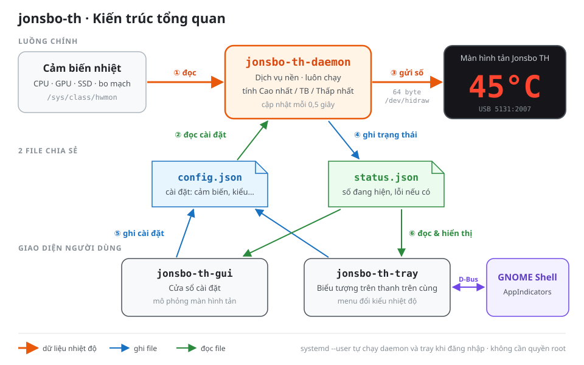

# jonsbo-th-display-linux

Linux driver and control panel for the two-digit temperature display on **Jonsbo TH-series AIO coolers** (TH-240, TH-360). Jonsbo only ships Windows software. This project shows your CPU, GPU, SSD or motherboard temperature on the pump display under Ubuntu and other systemd-based distros.

> **Unofficial project.** It is not affiliated with, endorsed by, or supported by Jonsbo. See [Disclaimer](#disclaimer).



## Features

- **Background service** (systemd user unit) that updates the display twice a second and reconnects after unplug or suspend.
- **Settings window** (GTK4 / libadwaita) with a live 7-segment preview of what the pump is showing.
- **Pick your sensors:** CPU, GPU, NVMe/SSD, motherboard and anything else the kernel exposes through `hwmon`.
- **Highest / average / lowest** of the selected sensors, plus an adjustable offset.
- **Top-bar icon** with the current temperature, using the GNOME *Ubuntu AppIndicators* extension.
- Pure Python standard library + PyGObject. It needs no compiled code and no `hidapi`.

## Supported hardware

### Coolers

| Device | USB ID | Status |
|---|---|---|
| Jonsbo TH-240 | `5131:2007` | Tested |
| Jonsbo TH-360 | `5131:2007` | Same protocol per [htkhiem/jonsbo-th-linux](https://github.com/htkhiem/jonsbo-th-linux); not tested here |

The display shows up in `lsusb` as a *"MSR-101U Mini HID magnetic card reader"*. That is normal: the vendor reused a generic chip ID. Other products, such as some GameMax and ID-Cooling coolers and the Jonsbo D34 case, use the same ID **with different protocols**. Do not assume they are compatible.

### Temperature sources

Temperatures are read from the Linux kernel's `hwmon` interface (`/sys/class/hwmon`), not from the CPU directly, so any sensor with a kernel driver works.

| Platform | Kernel driver | Default sensor | Status |
|---|---|---|---|
| AMD Ryzen | `k10temp` (or `zenpower`) | `Tctl` (`Tdie` for zenpower) | Tested |
| Intel Core | `coretemp` | `Package id 0` | Supported, not yet tested on real hardware |
| ARM (Raspberry Pi, etc.) | varies (`cpu_thermal`, …) | first sensor found; select the right one manually | Works only if the SoC exposes its sensor through `hwmon`; thermal-zone-only boards are not supported yet |

Tried it on another platform or cooler? Please report the result in an [issue](https://github.com/huysien/jonsbo-th-display-linux/issues).

## Installation

### Option 1: Debian / Ubuntu package (recommended)

Download the `.deb` from [Releases](https://github.com/huysien/jonsbo-th-display-linux/releases), or build it yourself:

```sh
git clone https://github.com/huysien/jonsbo-th-display-linux.git
cd jonsbo-th-display-linux
./build-deb.sh
sudo apt install ./dist/jonsbo-th_*_all.deb
```

The package:
- installs a udev rule that gives the logged-in user access to the display;
- enables the background service and the top-bar icon for every user, and starts them right away for users who are logged in;
- adds **Jonsbo TH** to the application menu.

### Option 2: per-user install without a package

```sh
./install.sh
```

This installs into `~/.local/share/jonsbo-th` and your user's systemd units. It asks for `sudo` once, only to install the udev rule. Do not combine it with the `.deb`: the script refuses to run if the package is installed.

### Requirements

- Python ≥ 3.10, `python3-gi`, `gir1.2-gtk-4.0` (≥ 4.14) and `gir1.2-adw-1` (≥ 1.5). All of these are preinstalled on Ubuntu 24.04 and later.
- For the top-bar icon: GNOME's **Ubuntu AppIndicators** extension (`ubuntu-appindicators@ubuntu.com`), or any desktop with a StatusNotifierItem host, such as KDE Plasma.

## Usage

### 1. Check that the display responds

Run this before relying on the service, especially on a model that has not been tested yet:

```sh
jonsbo-th-daemon --test 42
```

The pump should show **42**. If you get `Permission denied`, unplug and replug the cooler's USB cable, or log out and back in, so the new udev rule is applied.

### 2. Let it run

After installation the background service starts on its own and, by default, shows the CPU temperature. Nothing else is required. It starts automatically every time you log in.

### 3. Change what is displayed

Open **Jonsbo TH** from the application menu, or run `jonsbo-th-gui`. Every change is saved immediately and picked up by the service within about half a second.

| Control | What it does |
|---|---|
| Display preview at the top | Shows exactly what the pump is showing right now. A yellow note means the service is not running and you are only seeing a preview; red means an error, such as no permission or display not found. |
| **Temperature mode** | **Highest**, **Average** or **Lowest** of the enabled sensors |
| **Offset (°C)** | Degrees added to or subtracted from the value before display, e.g. `-10` for older Ryzen CPUs whose `Tctl` reads high |
| **Run in background** | Turns the background service on or off for your user |
| **Top-bar icon** | Shows or hides the tray icon. It also enables the AppIndicators extension if it is off. |
| **Show temperature next to icon** | Shows the number next to the tray icon |
| **Sensors · CPU / GPU / Drives / Motherboard / Other** | One switch per sensor, with its live reading. Enable the sensors the mode should be computed from. |

Example: to show whichever is hotter, CPU or GPU, enable `CPU · Tctl` and `GPU · edge` and choose **Highest**.

The **☰ → About Jonsbo TH** menu shows the version, license and project links.

### 4. Top-bar icon

Click the thermometer icon in the top bar to:
- see the current value;
- switch between highest, average and lowest;
- toggle the number next to the icon;
- open the settings window.

**Hide icon** hides it until your next login. To turn it off permanently, use the switch in the settings window.

### 5. Command line and service management

| Command | Purpose |
|---|---|
| `jonsbo-th-gui` | Open the settings window |
| `jonsbo-th-daemon --test N` | Send the number `N` once and exit |
| `systemctl --user status jonsbo-th` | Background service status |
| `journalctl --user -u jonsbo-th -f` | Follow the service log |
| `systemctl --user restart jonsbo-th` | Restart the service |
| `systemctl --user status jonsbo-th-tray` | Top-bar icon status |
| `cat $XDG_RUNTIME_DIR/jonsbo-th/status.json` | What the service is sending right now, and the last error |

### 6. Configuration file

Settings are stored in `~/.config/jonsbo-th/config.json`. The settings window and the tray menu edit this file, and you can also edit it by hand. The service reloads it automatically.

```json
{
  "sensors": ["k10temp/Tctl", "amdgpu/edge"],
  "mode": "max",
  "offset": 0,
  "interval": 0.5,
  "tray_label": true
}
```

| Key | Values |
|---|---|
| `sensors` | Sensor IDs as `driver/label`; `null` = pick the CPU sensor automatically |
| `mode` | `max`, `avg` or `min` |
| `offset` | Degrees to add (may be negative) |
| `interval` | Update period in seconds (0.2–10) |
| `tray_label` | Show the number next to the tray icon |

### 7. Run before login (optional)

The service runs while you are logged in, like Jonsbo's Windows software. To start it at boot, before anyone logs in, enable lingering for your user:

```sh
loginctl enable-linger "$USER"
```

### Troubleshooting

| Symptom | Fix |
|---|---|
| `Permission denied` | Replug the cooler's USB cable, or log out and back in. Check `ls -l /dev/hidraw*` and confirm the rule exists in `/usr/lib/udev/rules.d/60-jonsbo-th.rules`. |
| "Display not found" | Run `lsusb \| grep 5131:2007`. If nothing shows up, the display's USB header is not connected. |
| Number looks too high (AMD) | Some Ryzen CPUs report `Tctl` with a +10–20 °C offset. Use **Offset (°C)** in the settings window. |
| No top-bar icon | Run `gnome-extensions enable ubuntu-appindicators@ubuntu.com`. Extensions are paused while the screen is locked. |
| No CPU sensor listed | Run `sensors` (from `lm-sensors`) to see what the kernel exposes. Load the right driver, e.g. `sudo modprobe coretemp`. |

### Uninstall

```sh
sudo apt remove jonsbo-th      # if installed from the .deb
./install.sh --uninstall       # if installed with install.sh
```

Your settings in `~/.config/jonsbo-th/` are kept. Delete that folder to remove them.

## How it works

The display is a USB HID device with 64-byte reports and no report ID. Every update is one write to `/dev/hidrawN`:

```
byte:  0    1    2    3     4 … 63
       01   02   00   <°C>  00 … 00
```

The display has two digits, so values are clamped to 0–99. This protocol was **reverse-engineered by the community**, not published by Jonsbo. Credit goes to [htkhiem/jonsbo-th-linux](https://github.com/htkhiem/jonsbo-th-linux) (GPL-3.0). This project is an independent Python implementation of the same protocol.

For the full design, see [docs/ARCHITECTURE.md](docs/ARCHITECTURE.md). It covers the components, data flow, IPC files, D-Bus integration, packaging and design decisions.

## Disclaimer

- **Not affiliated with Jonsbo.** "Jonsbo" and product names such as "TH-240" are trademarks of their respective owners. They are used here only to say which hardware this software works with.
- **Reverse-engineered protocol, use at your own risk.** The protocol is undocumented. Units and production batches may behave differently. Sending data to the device could cause it to malfunction, and in the worst case it could permanently damage the display. Using this software may affect your manufacturer warranty.
- **Not a safety or monitoring tool.** The number on the pump is for convenience only and may be stale, offset, or wrong, for example from sensor offsets such as AMD `Tctl`, a stopped service, or an unreadable sensor. Do not rely on it to protect your hardware. Use your BIOS/firmware thermal protection and proper monitoring tools.
- **No warranty.** This program is distributed in the hope that it will be useful, but **WITHOUT ANY WARRANTY**, without even the implied warranty of MERCHANTABILITY or FITNESS FOR A PARTICULAR PURPOSE. The authors are not liable for any damage to hardware, data loss, or other harm arising from its use. See sections 15–17 of the [GPL-3.0](LICENSE).

## License

Copyright © 2026 Huy Pham

This program is free software: you can redistribute it and/or modify it under the terms of the **GNU General Public License** as published by the Free Software Foundation, either **version 3** of the License, or (at your option) any later version. See [LICENSE](LICENSE).
