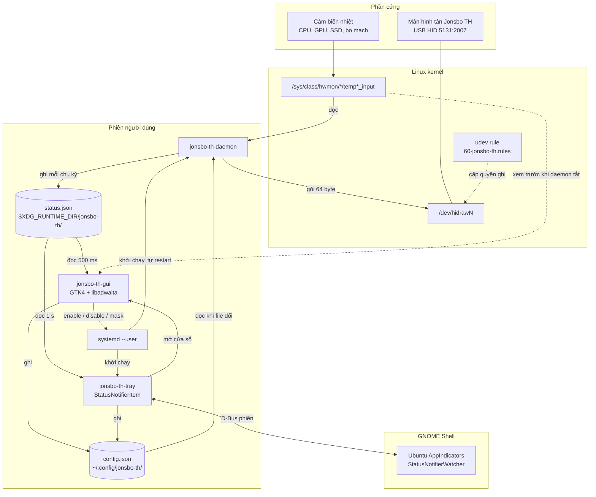
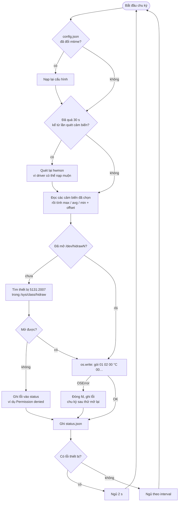
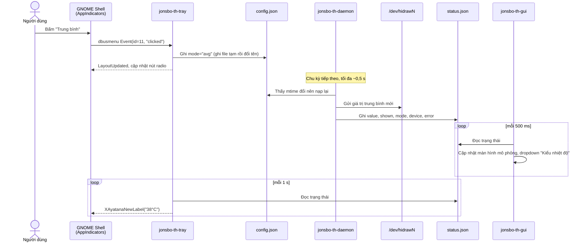
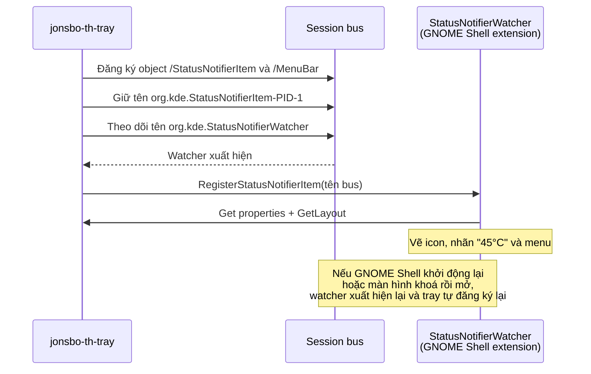
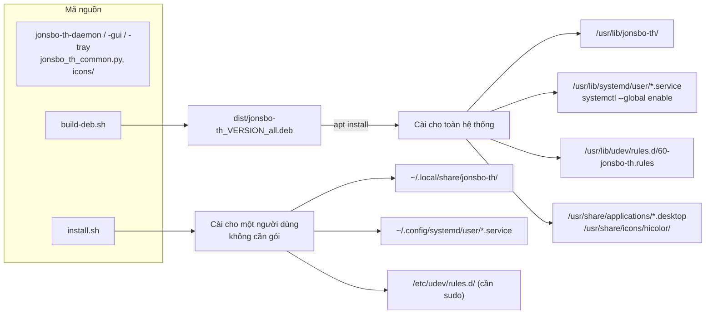

# Kiến trúc jonsbo-th

Tài liệu này mô tả:
- dự án gồm những thành phần nào;
- các thành phần trao đổi dữ liệu với nhau ra sao;
- vì sao chọn thiết kế này.

Các sơ đồ viết bằng [Mermaid](https://mermaid.js.org/), GitHub tự vẽ khi xem file.

## 1. Tổng quan


**Đọc sơ đồ theo số:**
1. Daemon đọc nhiệt độ từ các cảm biến.
2. Daemon đọc cài đặt trong `config.json`: dùng cảm biến nào, kiểu Cao nhất / Trung bình / Thấp nhất.
3. Daemon gửi con số xuống màn hình tản qua USB.
4. Daemon ghi con số vừa gửi vào `status.json`.
5. GUI hoặc biểu tượng tray ghi cài đặt mới khi người dùng thay đổi.
6. GUI và tray đọc `status.json` để hiện đúng con số đang có trên tản.


Dự án gồm **3 tiến trình độc lập**, cùng chạy dưới quyền người dùng đang đăng nhập (không chạy bằng root). Chúng dùng chung một module Python. Các tiến trình không gọi trực tiếp lẫn nhau, mà chỉ trao đổi qua **2 file JSON**:

| Thành phần | File | Vai trò | Cách chạy |
|---|---|---|---|
| **Daemon** | `jonsbo-th-daemon` | Đọc cảm biến, tính giá trị và gửi xuống màn hình tản. Đây là thành phần duy nhất ghi vào USB. | systemd user service `jonsbo-th.service`, luôn chạy |
| **GUI** | `jonsbo-th-gui` | Cửa sổ cài đặt, mô phỏng màn hình tản, bật/tắt các dịch vụ | Người dùng mở từ menu ứng dụng hoặc từ tray |
| **Tray** | `jonsbo-th-tray` | Biểu tượng và menu trên thanh trên cùng của GNOME | systemd user service `jonsbo-th-tray.service`, chạy theo phiên đồ hoạ |
| **Common** | `jonsbo_th_common.py` | Liệt kê cảm biến, đọc/ghi cấu hình, đọc/ghi trạng thái, tạo gói USB | Module được 3 tiến trình trên import |

Sơ đồ chi tiết hơn, có thêm đường dẫn hệ thống, udev và systemd:



## 2. Luồng dữ liệu chính

### 2.1 Vòng lặp của daemon

Mỗi chu kỳ (mặc định 0,5 giây), daemon làm theo thứ tự:



Daemon tự phục hồi trong các trường hợp:
- **rút cáp USB, cho máy ngủ hoặc tắt màn hình:** `write` báo lỗi, daemon đóng fd, chờ 2 giây rồi tự tìm lại thiết bị;
- **driver cảm biến nạp chậm sau khi khởi động:** daemon quét lại danh sách cảm biến mỗi 30 giây;
- **daemon bị crash:** systemd khởi động lại sau 3 giây (`Restart=always`).

### 2.2 Người dùng đổi cài đặt

Ví dụ: chọn "Trung bình" từ menu trên thanh trên cùng.



Đổi cài đặt trong GUI cũng đi theo đúng luồng này, chỉ khác là GUI ghi `config.json` thay cho tray. GUI và tray đều theo dõi `mtime` của file, nên đổi ở một bên thì bên kia tự cập nhật.

## 3. Giao tiếp giữa các thành phần

### 3.1 `config.json`: GUI và tray ghi, daemon đọc

Đường dẫn: `$XDG_CONFIG_HOME/jonsbo-th/config.json`, mặc định là `~/.config/jonsbo-th/config.json`.

```json
{
  "sensors": ["k10temp/Tctl", "k10temp/Tccd1"],
  "mode": "max",
  "offset": 0.0,
  "interval": 0.5,
  "tray_label": true
}
```

| Khoá | Ý nghĩa |
|---|---|
| `sensors` | Danh sách ID cảm biến dạng `driver[#n]/label`. Giá trị `null` nghĩa là tự chọn CPU: Tctl, rồi Tdie, rồi Package id 0. |
| `mode` | `max`, `avg` hoặc `min`, tính trên các cảm biến đã chọn |
| `offset` | Số độ cộng thêm trước khi hiển thị |
| `interval` | Chu kỳ cập nhật, giới hạn trong khoảng 0,2–10 giây |
| `tray_label` | Có hiện nhiệt độ cạnh biểu tượng tray hay không |

ID cảm biến dùng **tên driver và nhãn**, không dùng số `hwmonN`. Lý do là kernel có thể đánh số `hwmonN` khác đi sau mỗi lần khởi động.

### 3.2 `status.json`: daemon ghi, GUI và tray đọc

Đường dẫn: `$XDG_RUNTIME_DIR/jonsbo-th/status.json`. Thư mục này nằm trong RAM và bị xoá khi đăng xuất.

```json
{
  "value": 44.75, "shown": 45, "mode": "max",
  "device": "/dev/hidraw8", "error": null,
  "readings": {"k10temp/Tctl": 44.75, "amdgpu/edge": 39.0},
  "time": 1794650000.12, "pid": 4242
}
```

Nếu `time` cũ hơn **3 giây**, GUI và tray coi như daemon không chạy:
- GUI tự đọc cảm biến và hiện **bản xem trước**, kèm cảnh báo màu vàng;
- tray hiện dòng "Dịch vụ nền chưa chạy".

Mọi lần ghi JSON đều **atomic**: ghi vào file tạm cùng thư mục rồi `os.replace`. Nhờ vậy bên đọc không bao giờ đọc phải file ghi dở.

### 3.3 Giao thức USB: daemon và màn hình tản

Màn hình là thiết bị USB HID, report dài 64 byte, report descriptor không khai báo report ID. Mỗi lần cập nhật là **một lần `write()` 64 byte** vào `/dev/hidrawN`:

| Byte | 0 | 1 | 2 | 3 | 4…63 |
|---|---|---|---|---|---|
| Giá trị | `0x01` | `0x02` | `0x00` | nhiệt độ °C (0–99) | `0x00` |

- Byte 0 khác 0, nên kernel gửi nguyên cả 64 byte xuống thiết bị.
- Màn hình chỉ có 2 chữ số, nên giá trị được làm tròn rồi giới hạn trong khoảng 0–99.
- Giao thức do cộng đồng tự dò ra ([htkhiem/jonsbo-th-linux](https://github.com/htkhiem/jonsbo-th-linux)). Jonsbo không công bố tài liệu.

### 3.4 D-Bus: tray và GNOME Shell

Tray tự cài đặt hai giao diện D-Bus bằng `Gio`, không dùng thư viện AppIndicator:

| Đối tượng | Interface | Dùng để |
|---|---|---|
| `/StatusNotifierItem` | `org.kde.StatusNotifierItem` | Icon, tooltip, nhãn nhiệt độ (`XAyatanaLabel`) |
| `/MenuBar` | `com.canonical.dbusmenu` | Menu: Mở cửa sổ, Cao nhất / Trung bình / Thấp nhất, Hiện nhiệt độ, Ẩn biểu tượng |



### 3.5 systemd và GNOME: điều khiển từ GUI

| Thao tác trong GUI | Lệnh thực thi |
|---|---|
| Bật dịch vụ | `systemctl --user unmask` rồi `enable --now` |
| Tắt dịch vụ | `systemctl --user disable --now`. Nếu unit vẫn được bật toàn cục (cài từ .deb) thì chạy thêm `mask --now`. |
| Bật biểu tượng khi chưa có watcher | `gnome-extensions enable ubuntu-appindicators@ubuntu.com` |
| Kiểm tra đã có chỗ hiện icon chưa | Gọi D-Bus `NameHasOwner("org.kde.StatusNotifierWatcher")` |

GUI chỉ chạy một bản duy nhất, nhờ cơ chế `GtkApplication` với ID `io.github.jonsbo_th.Control`. Khi tray mở GUI lần thứ hai, cửa sổ đang mở sẽ được đưa lên trước thay vì tạo cửa sổ mới.

## 4. Đóng gói và cài đặt



| Mã nguồn | Gói .deb cài vào | `install.sh` cài vào |
|---|---|---|
| `jonsbo-th-daemon`, `-gui`, `-tray`, `jonsbo_th_common.py` | `/usr/lib/jonsbo-th/`, kèm symlink trong `/usr/bin/` | `~/.local/share/jonsbo-th/` |
| `icons/jonsbo-th-tray-symbolic.svg` | `/usr/lib/jonsbo-th/icons/` | `~/.local/share/jonsbo-th/icons/` |
| `jonsbo-th.svg` | `/usr/share/icons/hicolor/scalable/apps/` | `~/.local/share/icons/hicolor/…` |
| Unit systemd (sinh trong script) | `/usr/lib/systemd/user/` | `~/.config/systemd/user/` |
| Udev rule (sinh trong script) | `/usr/lib/udev/rules.d/` | `/etc/udev/rules.d/` |

Hai cách cài loại trừ nhau: nếu gói .deb đã được cài thì `install.sh` từ chối chạy. Số phiên bản chỉ khai báo ở một chỗ là `VERSION` trong `jonsbo_th_common.py`, và `build-deb.sh` tự đọc từ đó.

Các script đi kèm gói .deb:
- `postinst`: nạp lại udev, `systemctl --global enable`, khởi động dịch vụ cho người dùng đang đăng nhập;
- `prerm`: dừng và tắt dịch vụ;
- `postrm`: nạp lại udev, cập nhật cache icon và file .desktop.

## 5. Quyết định thiết kế

| Quyết định | Lý do |
|---|---|
| **Tách daemon khỏi GUI** | Màn hình tản phải chạy liên tục kể cả khi không mở cửa sổ. GUI hay tray bị lỗi cũng không ảnh hưởng việc hiển thị. |
| **Trao đổi qua file JSON thay vì D-Bus hay socket riêng** | Đơn giản và dễ debug (`cat status.json`). Không có thứ tự khởi động bắt buộc: thành phần nào chạy trước cũng được. Lượng dữ liệu nhỏ, cập nhật chậm. |
| **systemd *user* service, không phải service hệ thống** | Không cần chạy bằng root. Quyền ghi USB được cấp qua udev (`uaccess` cho người dùng đang ngồi trước máy, `plugdev` cho nhóm). Cấu hình nằm sẵn trong thư mục home. |
| **Ghi thẳng `/dev/hidraw` thay vì dùng `hidapi`** | Không cần thư viện biên dịch hay pip. Mỗi lần cập nhật chỉ là một `write()`. |
| **Tự cài StatusNotifierItem bằng Gio** | Thư viện AppIndicator chỉ chạy với GTK3, không trộn được với GTK4 trong cùng tiến trình. Typelib của nó cũng không cài sẵn trên Ubuntu. |
| **Vẽ màn hình mô phỏng bằng Gsk thay vì Cairo** | `python3-gi-cairo` không được cài sẵn. Gsk là phần có sẵn của GTK4. |
| **ID cảm biến theo `driver/label`** | Số `hwmonN` có thể đổi sau mỗi lần khởi động. |
| **Chỉ dùng thư viện chuẩn và PyGObject** | Ubuntu cài sẵn đủ cả, nên gói .deb là `Architecture: all` và chỉ nặng khoảng 15 KB. |

## 6. Giới hạn đã biết

- Màn hình chỉ hiện được số nguyên từ 0 đến 99. Chưa rõ giao thức có lệnh để tắt màn hình hay đổi độ sáng không.
- Dịch vụ chỉ chạy khi người dùng đã đăng nhập, giống phần mềm Windows của hãng. Muốn chạy từ lúc khởi động máy thì bật `loginctl enable-linger`.
- Biểu tượng trên thanh trên cùng cần phần mở rộng AppIndicators, hoặc một môi trường desktop có StatusNotifierItem như KDE. Khi màn hình đang khoá, GNOME tạm tắt mọi phần mở rộng.
- Mới thử trên TH-240. TH-360 dùng cùng giao thức theo dự án gốc. Các thiết bị khác cùng ID `5131:2007` **có thể dùng giao thức khác**.
