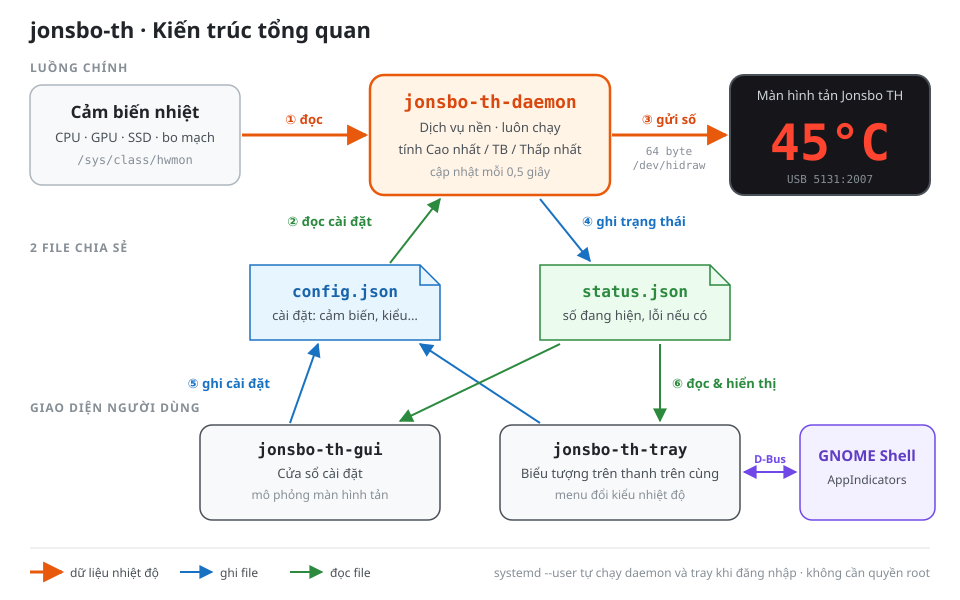
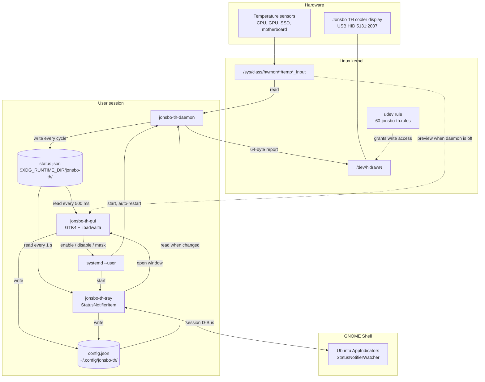
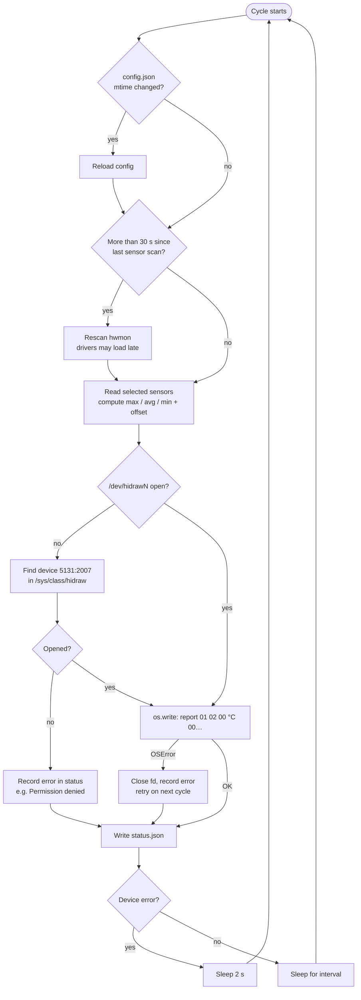
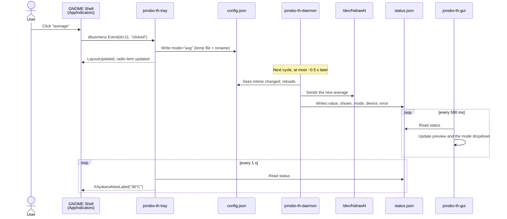
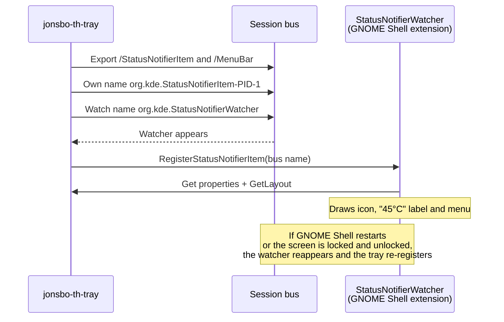
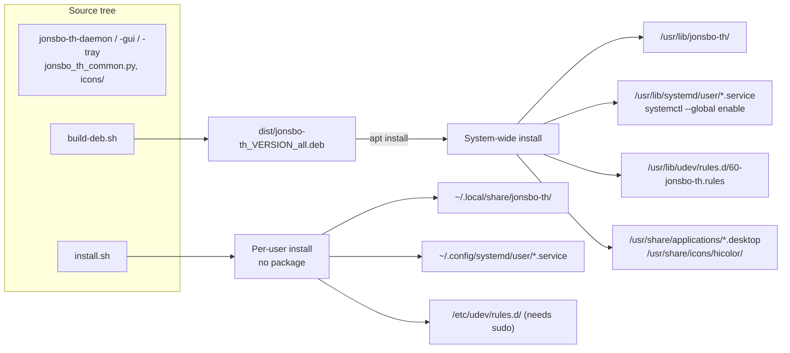

# jonsbo-th architecture

This document describes:
- which components the project consists of;
- how they exchange data;
- why it is designed this way.

Diagrams are written in [Mermaid](https://mermaid.js.org/), which GitHub renders automatically.

## 1. Overview



**Reading the diagram by number:**
1. The daemon reads temperatures from the sensors.
2. The daemon reads the settings in `config.json`: which sensors to use, and the highest / average / lowest mode.
3. The daemon sends the number to the cooler display over USB.
4. The daemon writes the number it just sent to `status.json`.
5. The GUI or the tray icon writes new settings when the user changes something.
6. The GUI and the tray read `status.json` to show exactly what the cooler is displaying.

The project consists of **3 independent processes**. All of them run as the logged-in user, never as root, and they share one Python module. The processes never call each other directly; they communicate only through **2 JSON files**:

| Component | File | Role | How it runs |
|---|---|---|---|
| **Daemon** | `jonsbo-th-daemon` | Reads sensors, computes the value and sends it to the cooler display. It is the only component that writes to USB. It also publishes the value as a dock-icon badge. | systemd user service `jonsbo-th.service`, always running |
| **GUI** | `jonsbo-th-gui` | Settings window, display preview, turns services on and off | Opened by the user from the app menu or from the tray |
| **Tray** | `jonsbo-th-tray` | Icon and menu in the GNOME top bar | systemd user service `jonsbo-th-tray.service`, tied to the graphical session |
| **Common** | `jonsbo_th_common.py` | Sensor discovery, config and status read/write, USB packet building | Module imported by the three processes above |

A more detailed diagram, including system paths, udev and systemd:



## 2. Main data flows

### 2.1 Daemon loop

Every cycle (0.5 s by default), the daemon does the following in order:



The daemon recovers on its own when:
- **the USB cable is unplugged or the system suspends:** `write` fails, the daemon closes the fd, waits 2 seconds and looks for the device again;
- **sensor drivers load late after boot:** the daemon rescans the sensor list every 30 seconds;
- **the daemon crashes:** systemd restarts it after 3 seconds (`Restart=always`).

### 2.2 The user changes a setting

Example: choosing "average" from the top-bar menu.



A change made in the GUI follows the same flow; the only difference is that the GUI writes `config.json` instead of the tray. Both the GUI and the tray watch the file's `mtime`, so a change made in one shows up in the other automatically.

## 3. Interfaces between components

### 3.1 `config.json`: written by the GUI and tray, read by the daemon

Path: `$XDG_CONFIG_HOME/jonsbo-th/config.json`, which defaults to `~/.config/jonsbo-th/config.json`.

```json
{
  "sensors": ["k10temp/Tctl", "k10temp/Tccd1"],
  "mode": "max",
  "offset": 0.0,
  "interval": 0.5,
  "tray_label": true,
  "dock_badge": true
}
```

| Key | Meaning |
|---|---|
| `sensors` | List of sensor IDs in the form `driver[#n]/label`. `null` means pick the CPU sensor automatically: Tctl, then Tdie, then Package id 0. |
| `mode` | `max`, `avg` or `min`, computed over the selected sensors |
| `offset` | Degrees added before display |
| `interval` | Update period, limited to 0.2–10 seconds |
| `tray_label` | Whether to show the temperature next to the tray icon |
| `dock_badge` | Whether the daemon shows the temperature as a badge on the dock icon |

Sensor IDs use the **driver name and label**, not the `hwmonN` number, because the kernel may number `hwmonN` devices differently on each boot.

### 3.2 `status.json`: written by the daemon, read by the GUI and tray

Path: `$XDG_RUNTIME_DIR/jonsbo-th/status.json`. This directory lives in RAM and is removed at logout.

```json
{
  "value": 44.75, "shown": 45, "mode": "max",
  "device": "/dev/hidraw8", "error": null,
  "readings": {"k10temp/Tctl": 44.75, "amdgpu/edge": 39.0},
  "time": 1794650000.12, "pid": 4242
}
```

If `time` is older than **3 seconds**, the GUI and the tray treat the daemon as not running:
- the GUI reads the sensors itself and shows a **preview**, with a yellow warning;
- the tray shows a "service not running" line.

Every JSON write is **atomic**: the data goes to a temporary file in the same directory, then `os.replace` swaps it in. Readers never see a half-written file.

### 3.3 USB protocol: daemon and cooler display

The display is a USB HID device with 64-byte reports, and its report descriptor declares no report ID. Each update is **one 64-byte `write()`** to `/dev/hidrawN`:

| Byte | 0 | 1 | 2 | 3 | 4…63 |
|---|---|---|---|---|---|
| Value | `0x01` | `0x02` | `0x00` | temperature in °C (0–99) | `0x00` |

- Byte 0 is non-zero, so the kernel sends all 64 bytes to the device unchanged.
- The display has only 2 digits, so the value is rounded and clamped to 0–99.
- The protocol was reverse-engineered by the community ([htkhiem/jonsbo-th-linux](https://github.com/htkhiem/jonsbo-th-linux)). Jonsbo has not published any documentation.

### 3.4 D-Bus: tray and GNOME Shell

The tray implements two D-Bus interfaces itself using `Gio`, without the AppIndicator library:

| Object | Interface | Used for |
|---|---|---|
| `/StatusNotifierItem` | `org.kde.StatusNotifierItem` | Icon, tooltip, temperature label (`XAyatanaLabel`) |
| `/MenuBar` | `com.canonical.dbusmenu` | Menu: open window, highest / average / lowest, show temperature, hide icon |

The app icon in the dock is a static image, so the live value is shown as a **badge** instead. The **daemon** emits the `com.canonical.Unity.LauncherEntry.Update` signal from `/io/github/jonsbo_th/LauncherEntry`, with `application://io.github.jonsbo_th.Control.desktop`, `count` (the displayed number) and `count-visible`. Ubuntu Dock / Dash to Dock, KDE and Plank all draw it. The signal is:
- sent when the value changes, and re-sent every 10 s so a restarted dock picks it up again;
- hidden when the display cannot be written to or the feature is turned off.

The daemon emits the badge, not the tray, so the badge keeps working when the tray icon is hidden. Without a session bus, for example when running from boot via lingering, the badge is skipped and retried later.



### 3.5 systemd and GNOME: controlled from the GUI

| GUI action | Command executed |
|---|---|
| Turn a service on | `systemctl --user unmask`, then `enable --now` |
| Turn a service off | `systemctl --user disable --now`. If the unit is still enabled globally (installed from the .deb), also `mask --now`. |
| Turn the tray on when no watcher exists | `gnome-extensions enable ubuntu-appindicators@ubuntu.com` |
| Check whether a tray host is available | D-Bus call `NameHasOwner("org.kde.StatusNotifierWatcher")` |

Only one GUI instance runs at a time, thanks to `GtkApplication` with the ID `io.github.jonsbo_th.Control`. When the tray launches the GUI a second time, the existing window is raised instead of opening a new one.

## 4. Packaging and installation



| Source | Installed by the .deb to | Installed by `install.sh` to |
|---|---|---|
| `jonsbo-th-daemon`, `-gui`, `-tray`, `jonsbo_th_common.py` | `/usr/lib/jonsbo-th/`, with symlinks in `/usr/bin/` | `~/.local/share/jonsbo-th/` |
| `icons/jonsbo-th-tray-symbolic.svg` | `/usr/lib/jonsbo-th/icons/` | `~/.local/share/jonsbo-th/icons/` |
| `jonsbo-th.svg` | `/usr/share/icons/hicolor/scalable/apps/` | `~/.local/share/icons/hicolor/…` |
| systemd units (generated by the script) | `/usr/lib/systemd/user/` | `~/.config/systemd/user/` |
| udev rule (generated by the script) | `/usr/lib/udev/rules.d/` | `/etc/udev/rules.d/` |

The two install methods are mutually exclusive: `install.sh` refuses to run if the .deb is installed. The version number is defined in one place only, `VERSION` in `jonsbo_th_common.py`, and `build-deb.sh` reads it from there.

Maintainer scripts in the .deb:
- `postinst`: reloads udev, runs `systemctl --global enable`, and starts the services for users who are logged in;
- `prerm`: stops and disables the services;
- `postrm`: reloads udev and refreshes the icon cache and desktop database.

## 5. Design decisions

| Decision | Rationale |
|---|---|
| **Daemon separate from the GUI** | The cooler display must keep updating when no window is open. A GUI or tray failure does not affect the display. |
| **JSON files instead of D-Bus or a custom socket for IPC** | Simple and easy to debug (`cat status.json`). No required start-up order: any component can start first. The data is small and changes slowly. |
| **systemd *user* services, not system services** | Nothing runs as root. USB write access comes from udev (`uaccess` for the user at the seat, `plugdev` for the group). Configuration naturally lives in the home directory. |
| **Write `/dev/hidraw` directly instead of using `hidapi`** | No compiled library or pip install needed. Each update is a single `write()`. |
| **Own StatusNotifierItem implementation with Gio** | The AppIndicator library only works with GTK3 and cannot be mixed with GTK4 in one process. Its typelib is also not preinstalled on Ubuntu. |
| **Preview drawn with Gsk instead of Cairo** | `python3-gi-cairo` is not preinstalled. Gsk is part of GTK4. |
| **Sensor IDs based on `driver/label`** | `hwmonN` numbers can change between boots. |
| **Standard library + PyGObject only** | Ubuntu ships everything needed, so the .deb is `Architecture: all` and only about 15 KB. |

## 6. Known limitations

- The display can only show integers from 0 to 99. It is not known whether the protocol has commands to turn the display off or change its brightness.
- The services run only while the user is logged in, like Jonsbo's Windows software. To run from boot, enable `loginctl enable-linger`.
- The top-bar icon needs the AppIndicators extension, or a desktop with a StatusNotifierItem host such as KDE. GNOME pauses all extensions while the screen is locked.
- Only `hwmon` sensors are read. ARM boards that expose CPU temperature only as a thermal zone (`/sys/class/thermal`) are not supported yet.
- Tested on the TH-240 only. The TH-360 uses the same protocol according to the original project. Other devices with the ID `5131:2007` **may use a different protocol**.
